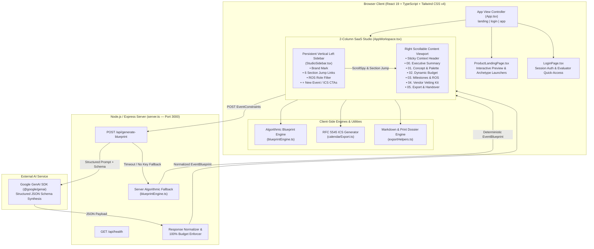
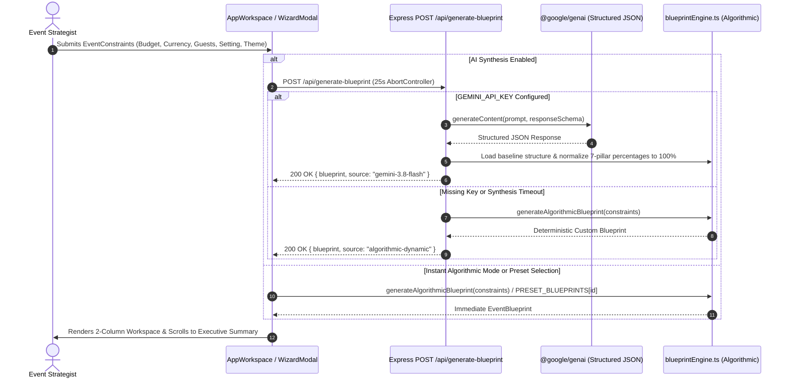
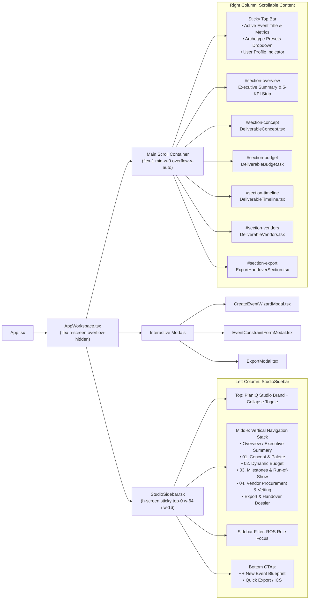
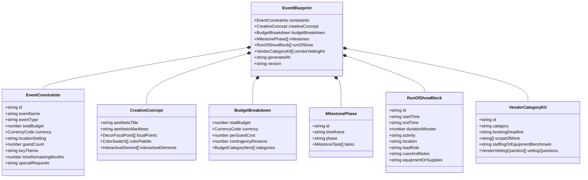

# PlanIQ Studio — Master Event Strategist & Logistics Blueprint Suite

**PlanIQ Studio** is a full-stack SaaS event engineering platform that transforms high-level event constraints (typology, total budget, currency, guest count, spatial setting, aesthetic theme, and planning horizon) into an execution-ready operational dossier.

It combines a **server-side structured AI synthesis pipeline** with a **deterministic algorithmic blueprint engine**, delivering a 2-column SaaS workbench with live budget rebalancing, role-filtered day-of orchestration, forensic vendor vetting kits, and RFC 5545 `.ics` calendar exports.

---

## Table of Contents

1. [System Architecture (Mermaid Diagrams)](#1-system-architecture-mermaid-diagrams)
   - [High-Level Full-Stack Architecture](#a-high-level-full-stack-architecture)
   - [Blueprint Generation & Fallback Sequence](#b-blueprint-generation--fallback-sequence)
   - [2-Column SaaS Studio Component Hierarchy](#c-2-column-saas-studio-component-hierarchy)
   - [Domain Data Model (`EventBlueprint`)](#d-domain-data-model-eventblueprint)
2. [Core Execution Deliverables](#2-core-execution-deliverables)
3. [Project Structure](#3-project-structure)
4. [API Reference](#4-api-reference)
5. [Getting Started & Commands](#5-getting-started--commands)

---

## 1. System Architecture (Mermaid Diagrams)

### A. High-Level Full-Stack Architecture

PlanIQ Studio runs as a unified Express + Vite application on port `3000`. The frontend communicates with backend synthesis endpoints while maintaining instant client-side reactivity for budget sliders, task checklists, role filtering, and file exports.



---

### B. Blueprint Generation & Fallback Sequence

When a user creates a new event via the 4-step `CreateEventWizardModal` or edits constraints via `EventConstraintFormModal`, the system guarantees a complete, schema-valid `EventBlueprint` through a resilient dual-engine flow:



---

### C. 2-Column SaaS Studio Component Hierarchy

The workspace uses a strict 2-column SaaS layout: a fixed full-height vertical navigation sidebar on the left (`w-64`, collapsible to `w-16`) paired with an independently scrollable content viewport (`flex-1 min-w-0 overflow-y-auto`) on the right.



---

### D. Domain Data Model (`EventBlueprint`)

Every preset, algorithmic output, and AI-synthesized plan conforms strictly to the `EventBlueprint` TypeScript contract in `src/types/blueprint.ts`:



---

## 2. Core Execution Deliverables

Each generated blueprint produces five interconnected modules inside the workspace:

1. **Overview / Executive Summary (`#section-overview`)**
   - Displays event typology, spatial setting, aesthetic theme, revision tag, and a 5-card tabular metric strip (**Total Budget & Per-Guest Cost**, **Confirmed Guest Count**, **Spatial Setting**, **Planning Horizon**, and **Task & Schedule Readiness**).
2. **01. Concept & Palette (`DeliverableConcept.tsx`)**
   - **Aesthetic Manifesto**: Editorial thesis statement governing spatial design.
   - **3 Decor Focal Points**: Architectural zones with specific material specifications.
   - **Curated 5-Color Palette**: Interactive hex swatches with one-click clipboard copy, color roles, and lighting notes.
   - **3 Signature Interactive Elements**: Guest touchpoints mapped to target moments and logistical requirements.
3. **02. Dynamic Budget (`DeliverableBudget.tsx`)**
   - **7-Pillar Allocation Table**: Venue & Facilities, Food & Beverage, Decor & Spatial Lighting, Photography & AV, Entertainment & Music, Attire/Favors/Touchpoints, and Contingency Reserve.
   - **Interactive Percentage Sliders & Live Total Capital Input**: Adjust total budget or individual pillar percentages with one-click **Normalize to 100%** auto-rebalancing.
   - **Cost-Optimization Strategies**: 2 actionable value-engineering tips per category to protect quality while reducing spend.
4. **03. Milestones & Run-of-Show (`DeliverableTimeline.tsx`)**
   - **Backward Planning Checklists**: Phased milestones from current month down to event week with interactive task completion tracking and progress bars.
   - **Minute-by-Minute Day-of Run-of-Show**: Chronological schedule blocks from load-in to strike, filterable by **Lead Role** (`Logistics Director`, `Master of Ceremonies`, `Stage Manager`, `Catering Lead`, `Photo/Video Lead`, `Event Host / VIP`) from either the timeline toolbar or the left sidebar.
5. **04. Vendor Procurement & Vetting (`DeliverableVendors.tsx`)**
   - **4 Core Procurement Pillars**: Catering & Beverage, Photo & Cinema, Venue Operations, and Floral & Spatial Decor.
   - **Anti-Hidden-Fee Vetting Matrix**: 3 forensic interview questions per vendor category pairing **Why It Matters**, **Green Flag Answer**, and **Red Flag Trap** alongside staffing ratios and turnkey scopes of work.
6. **Export & Handover Dossier (`ExportHandoverSection.tsx` & `ExportModal.tsx`)**
   - **RFC 5545 `.ics` Calendar Export**: Downloads a standard calendar file containing all Run-of-Show blocks with locations, lead roles, and technical cues.
   - **Markdown & JSON Dossier Export**: One-click clipboard copy or file download of the full blueprint.
   - **Print-Optimized Production Binder**: Dedicated print stylesheet for physical day-of clipboards.

---

## 3. Project Structure

```text
├── index.html                              # App entry HTML & typography imports
├── metadata.json                           # AI Studio applet metadata & capabilities
├── package.json                            # Dependencies & full-stack build/dev scripts
├── server.ts                               # Express server, API routes & Vite middleware
├── tsconfig.json                           # TypeScript configuration
├── vite.config.ts                          # Vite bundler & Tailwind CSS v4 plugin setup
└── src/
    ├── main.tsx                            # React DOM root mount
    ├── App.tsx                             # Top-level view state (landing | login | app)
    ├── index.css                           # Tailwind CSS v4 imports, custom scrollbars & print rules
    ├── types/
    │   ├── auth.ts                         # Authenticated user session types
    │   └── blueprint.ts                    # Complete EventBlueprint domain interfaces
    ├── components/
    │   ├── ProductLandingPage.tsx          # Public marketing & interactive preview page
    │   ├── LoginPage.tsx                   # Studio authentication & demo session entry
    │   ├── AppWorkspace.tsx                # 2-column SaaS dashboard shell & ScrollSpy controller
    │   ├── StudioSidebar.tsx               # Persistent vertical left navigation rail
    │   ├── DeliverableConcept.tsx          # 01. Creative concept, focal points & hex palette
    │   ├── DeliverableBudget.tsx           # 02. Interactive 7-pillar budget modeler
    │   ├── DeliverableTimeline.tsx         # 03. Backward milestones & role-filtered Run-of-Show
    │   ├── DeliverableVendors.tsx          # 04. Vendor SOWs & green/red flag vetting kit
    │   ├── ExportHandoverSection.tsx       # 05. Inline export & calendar download section
    │   ├── CreateEventWizardModal.tsx      # 4-step guided event constraint creation wizard
    │   ├── EventConstraintFormModal.tsx    # Quick-edit modal for active blueprint parameters
    │   └── ExportModal.tsx                 # Full preview & download modal (Markdown, ICS, JSON, Print)
    └── utils/
        ├── blueprintEngine.ts              # Curated presets, algorithmic generator & budget math
        ├── calendarExport.ts               # RFC 5545 .ics calendar generator
        └── exportHelpers.ts                # Markdown compiler & browser file download helpers
└── tests/
    ├── blueprintEngine.test.ts             # Unit tests for budget math, presets & algorithmic edge cases
    ├── calendarExport.test.ts              # Unit tests for RFC 5545 calendar formatting & midnight wrap
    ├── exportHelpers.test.ts               # Unit tests for Markdown dossier & ICS export helpers
    └── schemaIntegrity.test.ts             # End-to-end schema & domain contract verification
```

---

## 4. API Reference

| Method | Endpoint | Description |
| :--- | :--- | :--- |
| `GET` | `/api/health` | Returns server status, timestamp, and whether `GEMINI_API_KEY` is configured in the environment. |
| `POST` | `/api/generate-blueprint` | Accepts an `EventConstraints` JSON body and returns `{ blueprint: EventBlueprint, source: 'gemini-3.8-flash' \| 'algorithmic-dynamic' }`. Automatically normalizes budget percentages to 100% and falls back to the deterministic algorithmic engine if the AI call times out or no key is set. |

---

## 5. Getting Started & Commands

### Prerequisites
- **Node.js** `>= 20.x`
- **npm** `>= 10.x`

### Environment Variables
Copy `.env.example` to `.env` and optionally provide a `GEMINI_API_KEY` for live AI synthesis (the app also works out-of-the-box with its built-in deterministic algorithmic engine):

```bash
GEMINI_API_KEY=your_api_key_here
PORT=3000
```

### Development & Production Scripts

```bash
# Install dependencies
npm install

# Start full-stack Express + Vite development server on port 3000
npm run dev

# Type-check the codebase (including /src and /tests)
npm run lint

# Build production client bundle to dist/
npm run build

# Run the full automated test suite in /tests
npm test
```
