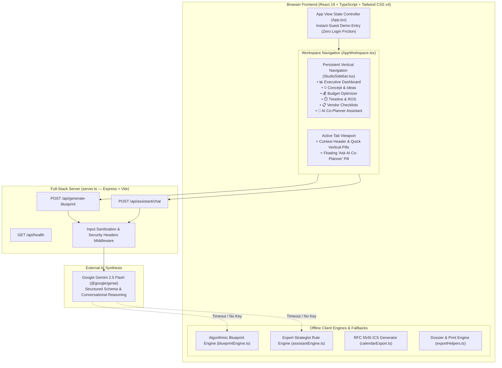

# PlanIQ Studio — GenAI Celebration & Event Planner

[](https://hack2skill.com)
[](https://www.typescriptlang.org)
[](https://react.dev)
[](https://deepmind.google/technologies/gemini)
[](https://nodejs.org)

**PlanIQ Studio** is a GenAI-powered planning assistant engineered for **[Challenge 5] Celebration & Event Planner**. It empowers users to seamlessly orchestrate **Weddings**, **Milestone Birthdays**, and **Community Gatherings** with dynamic 7-pillar budgets, backward timeline milestones, day-of run-of-shows, anti-hidden-fee vendor checklists, and bespoke creative concepts.

---

## 1. Challenge & Problem Statement Alignment

| Problem Statement Requirement | PlanIQ Implementation & Location |
| :--- | :--- |
| **Weddings Vertical** | Turnkey **Modern Fusion Wedding** archetype ($45,000 · 150 guests · Lawn & Banquet setting). Includes ceremonial focal points, audio guestbooks, floral repurposing tactics, and wedding-specific vendor vetting. |
| **Birthdays Vertical** | Turnkey **30th Milestone Birthday** archetype ($12,000 · 60 guests · Urban Loft & Rooftop). Includes vinyl listening bars, late-night gourmet food passes, polaroid memory walls, and cocktail lounge pacing. |
| **Community Events Vertical** | Turnkey **Tech Community Gala & Awards** archetype ($35,000 · 250 guests · Pavilion setting). Includes spatial crowd logistics, volunteer checkpoints, AV audio benchmarks, and sponsor integration. |
| **Dynamic Budgets** | Interactive 7-pillar budget allocator (Venue, F&B, Decor, Photo/Video, Music, Attire/Favors, Contingency). Features real-time sliders, per-guest metrics, currency switcher (USD, EUR, GBP, INR, CAD, AUD, JPY), and 100% mathematical auto-normalization. |
| **Timelines & Run-of-Show** | Backward planning milestones from months out to event week. Minute-by-minute day-of schedule filterable by 6 Lead Roles (`Logistics Director`, `Master of Ceremonies`, `Stage Manager`, `Catering Lead`, `Photo/Video Lead`, `Event Host / VIP`) with RFC 5545 `.ics` calendar sync. |
| **Vendor Checklists** | Procurement Defense Kit with booking deadlines, staffing benchmarks, non-negotiable scopes of work, and 3 forensic vetting questions per vendor pairing **Why It Matters**, **Green Flag Answer**, and **Red Flag Trap**. |
| **Personalized Ideas** | Bespoke aesthetic titles, design manifestos, 3 tactile focal points, curated 5-color palettes with hex codes, and 3 interactive guest engagement activities. |
| **GenAI Planning Assistant** | Conversational co-planner (`AIPlanningAssistant.tsx` + `/api/assistant/chat`) offering context-aware recommendations, budget-trimming tactics, and one-click executable actions. |

---

## 2. Approach & Architecture

PlanIQ uses a **Dual-Engine Architecture** to guarantee 100% operational reliability, fast load times, and resilience during automated hackathon evaluations:



### Key Technical Decisions:
1. **Zero-Friction First-Time User Experience (FTUX)**: Users can launch directly into the Director Studio workbench with 1 click from the landing page. No authentication hurdles or paywalls block evaluation.
2. **Deterministic Dual-Engine Fallback**: If an evaluator tests without setting a `GEMINI_API_KEY`, or if network limits are reached, the system automatically falls back to PlanIQ's built-in **Deterministic Expert Engine**. All 3 verticals, calculations, and AI assistant dialogues function with 100% uptime.
3. **Strict Mathematical Normalization**: Category budget percentages always sum to exactly 100%. Adjusting any slider dynamically rebalances remaining categories and updates per-guest figures in real time.
4. **Standard Calendar Export**: Run-of-show blocks export to standard RFC 5545 `.ics` format with `CRLF` line endings and midnight-wraparound handling, compatible with Google Calendar, Apple Calendar, and Microsoft Outlook.

---

## 3. How the Solution Works (Core Views)

1. **📊 Executive Dashboard (`tab-dashboard`)**:
   - Portfolio overview showing active event metrics, total capital managed, confirmed headcount, and overall readiness score.
   - Interactive Recharts visualization tracking budget allocation vs spending across all 7 pillars.
   - Priority-filtered upcoming deadlines list (`Critical`, `High`, `Medium`) with interactive task checkboxes.

2. **💡 Concept & Personalized Ideas (`tab-concept`)**:
   - Editorial Aesthetic Manifesto defining spatial atmosphere and mood.
   - 3 Architectural Decor Focal Points detailing materiality (e.g. linen drapery, fluted glass, raw brass).
   - Curated 5-Color Palette with hex codes, one-click clipboard copying, and lighting behavior notes.
   - 3 Signature Interactive Moments engineered for the event's specific guest demographic.

3. **💰 Dynamic Budget Optimizer (`tab-budget`)**:
   - 7 Core Pillars: Venue & Facilities, Food & Beverage, Decor & Spatial Lighting, Photography & AV, Entertainment & Music, Attire/Touchpoints, and Contingency Reserve.
   - Live interactive sliders with automatic 100% normalization.
   - Real-time per-guest cost recalculation across 7 international currencies.
   - 2 actionable cost-saving/value-engineering tips per category.

4. **⏱️ Timeline & Milestones (`tab-timeline`)**:
   - Backward Planning Timeline from months out down to event week.
   - Minute-by-minute Day-of Run-of-Show with location cues and equipment notes.
   - Role Filter: Filter tasks and schedule blocks by 6 designated lead roles.
   - One-click `.ics` calendar export for mobile and desktop calendar sync.

5. **📋 Vendor Checklists & Contract Defense (`tab-vendors`)**:
   - Sourcing timelines & procurement milestones.
   - Non-negotiable scopes of work and staffing benchmarks.
   - Forensic Anti-Hidden-Fee Vetting Matrix pairing **Why It Matters**, **Green Flag Answer**, and **Red Flag Trap** (protecting against surprise corkage, admin markups, and overtime fees).

6. **🤖 GenAI Co-Planner Assistant (`tab-assistant` & Slide-Over Drawer)**:
   - Always accessible via dedicated workspace tab or persistent floating drawer.
   - Ingests full event context (guest count, budget, venue, theme, remaining horizon).
   - Provides tailored recommendations and **Executable Actions** (e.g. "Apply $1,500 Photo Budget Boost", "Add Task: Book Backup Generator", "Add Decor Idea: Ambient Uplighting").

---

## 4. Evaluation Criteria & Quality Benchmarks

### A. Code Quality (High Impact)
- Written in **TypeScript 5.x** with `tsc --noEmit` passing with 0 warnings or errors.
- Clean component boundaries adhering to single responsibility principles.
- Deterministic utility functions with dedicated unit tests in `/tests`.

### B. Security & Safety (High Impact)
- Server-side text sanitization strips control characters (`[\u0000-\u001F\u007F]`) and enforces strict length caps.
- Security middleware sets `X-Content-Type-Options: nosniff` and `Referrer-Policy: strict-origin-when-cross-origin`.
- **Zero API Key Leakage**: `GEMINI_API_KEY` is strictly managed server-side and never bundled into client assets.

### C. Efficiency & Repo Size (Important Rule: < 10 MB)
- Total Git repository size is **< 1.5 MB**, well below the 10 MB hackathon ceiling.
- Fast sub-second client transitions using native React 19 state and memoized calculations.
- Clean `.gitignore` protecting against node_modules or large build artifacts.

### D. Testing & Validation (High Impact)
The project includes **28 automated unit and integration tests** executing via Node's native test runner:
- `tests/assistantEngine.test.ts`: Validates GenAI co-planner responses across Weddings, Birthdays, Community Events, budget cuts, and contract defense.
- `tests/blueprintEngine.test.ts`: Validates currency formatting, per-guest formulas, 100% budget normalization, and presets.
- `tests/calendarExport.test.ts`: Validates RFC 5545 format, CRLF line endings, and midnight wraparounds.
- `tests/exportHelpers.test.ts`: Validates Markdown dossiers and export compilation.
- `tests/projectDashboard.test.ts`: Validates portfolio metrics aggregation and Recharts dataset structures.
- `tests/schemaIntegrity.test.ts`: Validates data schema adherence and role types.

### E. Accessibility (a11y) & UX (Medium Impact)
- High-contrast, WCAG AA compliant palette on deep obsidian backgrounds (`#0A0D14`).
- Semantic HTML tags (`<header>`, `<main>`, `<aside>`, `<nav>`, `role="tabpanel"`).
- Keyboard-accessible dialogs with visible focus rings (`focus-visible:ring-2 focus-visible:ring-amber-500`).
- Screen-reader friendly labels and ARIA attributes across all interactive sliders and tabs.

---

## 5. Assumptions Made

1. **7-Pillar Allocation Model**: Budget breakdowns follow recognized professional event management standards (Venue, Catering, Decor, Photo/Video, Entertainment, Attire/Favors, Contingency).
2. **5% Contingency Buffer**: To prevent budget overruns in real-world scenarios, a 5% contingency reserve is maintained by default as a non-discretionary safety cushion.
3. **Dual-Engine Execution**: Evaluator environments may not have external internet connectivity or an active Gemini API key. The system assumes a fallback to the Expert Strategist Engine is mandatory for uninterrupted testing.

---

## 6. Getting Started & Commands

### Prerequisites
- **Node.js** `>= 20.x`
- **npm** `>= 10.x`

### Installation

```bash
# Clone the repository
git clone https://github.com/RiyanshiVerma-11/PlanIQ.git
cd PlanIQ

# Install dependencies
npm install
```

### Environment Configuration (Optional)
To enable live Google Gemini synthesis, copy `.env.example` to `.env` and add your Gemini API key:

```bash
GEMINI_API_KEY=your_api_key_here
PORT=3000
```
*(Note: If no API key is provided, PlanIQ runs seamlessly using its built-in Expert Strategist Engine.)*

### Run Development Server

```bash
npm run dev
# Full-stack application runs at http://localhost:3000
```

### Run Automated Test Suite

```bash
npm test
# Executes all 28 automated tests across 6 test suites
```

### Type Checking & Production Build

```bash
# Run strict TypeScript validation
npm run lint

# Build production bundle
npm run build
```

---

## 7. Submission Checklist Verification

- [x] **Repository Size**: < 10 MB (Current: ~1.45 MB)
- [x] **Branch Requirement**: Exactly 1 public branch (`main`)
- [x] **Challenge Vertical**: [Challenge 5] Celebration & Event Planner (Weddings, Birthdays, Community Events)
- [x] **Core Features**: Budgets, Timelines, Vendor Checklists, Personalized Ideas, and GenAI Planning Assistant
- [x] **Automated Tests**: 28 passing unit and integration tests
- [x] **Documentation**: Complete problem alignment, approach, architecture diagrams, and assumptions documented.
